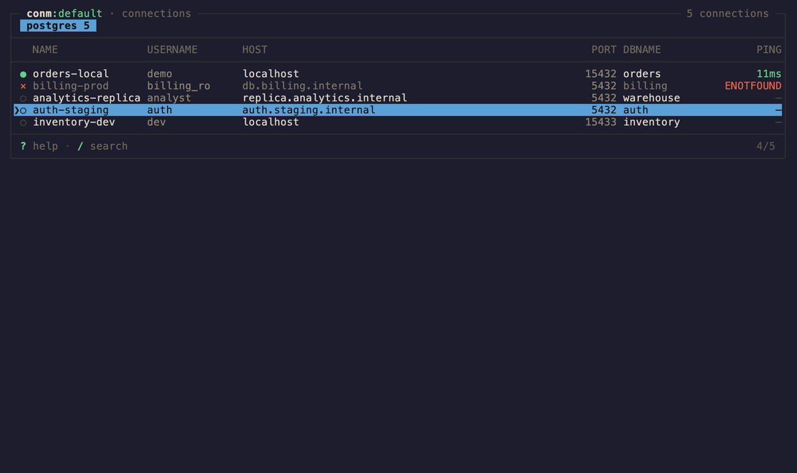
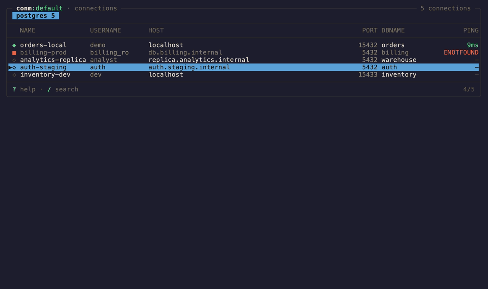
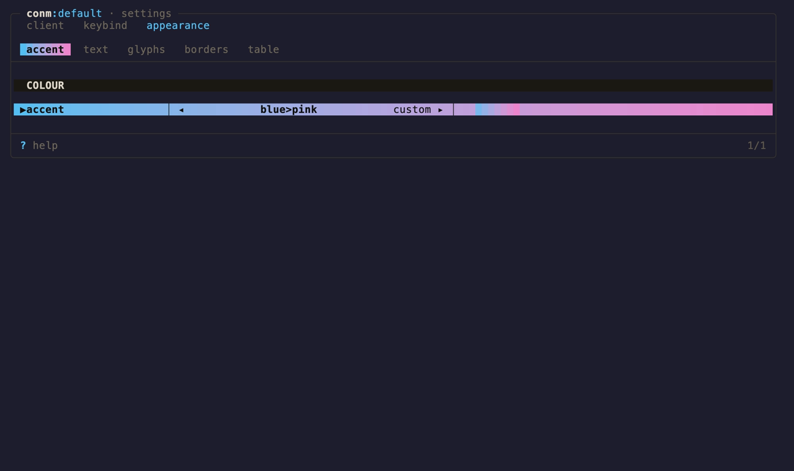
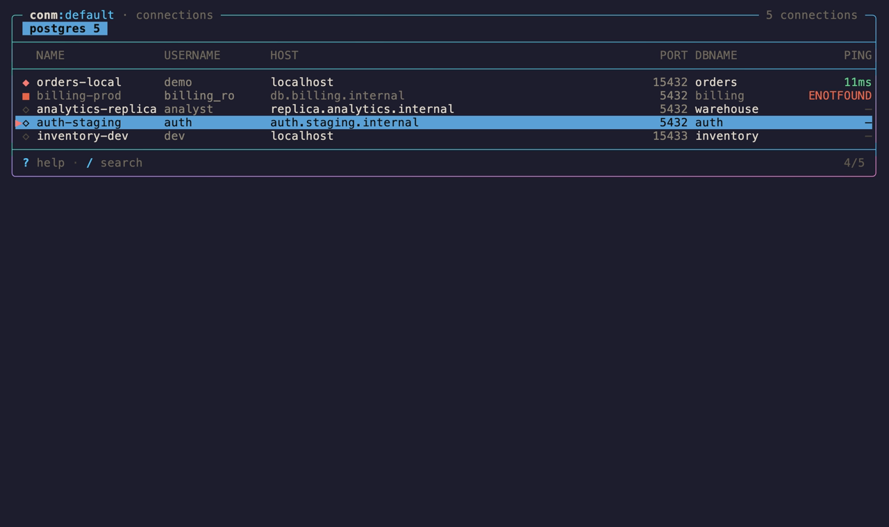
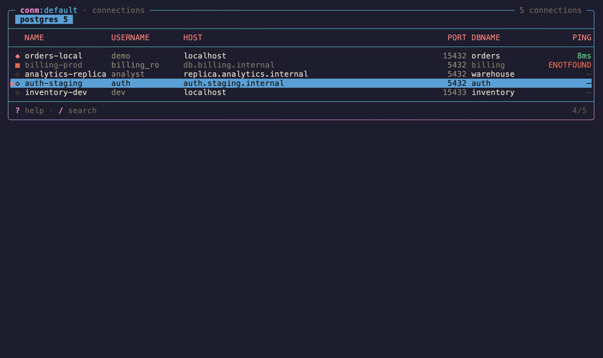
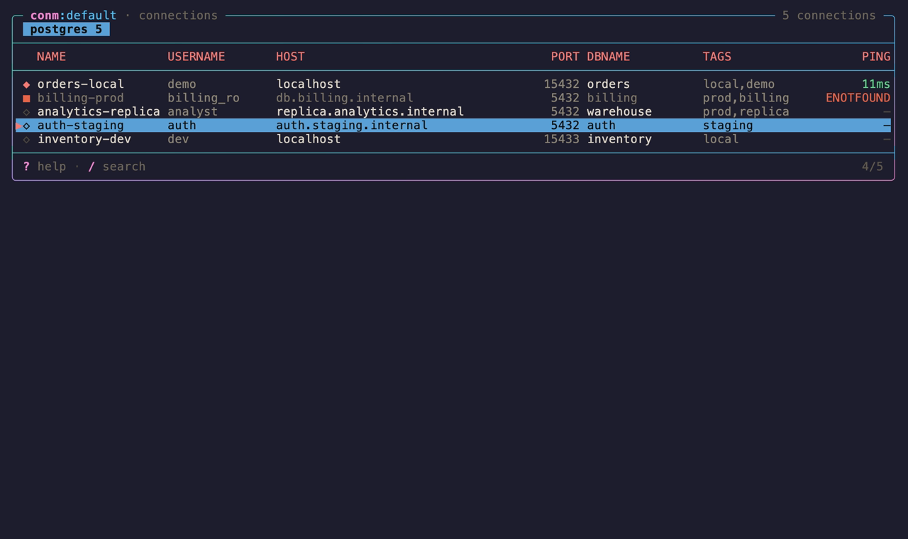
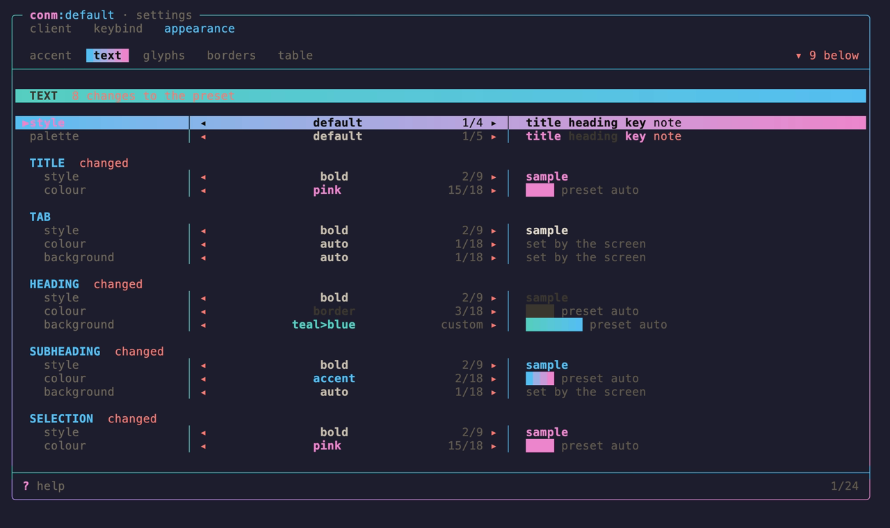

# Make conm yours

conm starts with a quiet, grey look. Almost everything you see can be changed: the frame, the
symbols, every colour — gradients included — how text is drawn, and which columns the
connections table shows for each type. This page takes one setup from the default to a fully
customised one, a layer at a time, so you can stop wherever you like.

Every change is made on the **appearance** tab of the [settings screen](additional-screens.md#settings)
and takes effect at once. Each step below also shows what it adds to `conm.toml`, if you would
rather edit the file; steps add to each other, so the last one is the whole setup. The
[appearance reference](additional-screens.md#appearance) lists every option.

## 1. The default

Nothing set: a single grey frame, round dots for the connection state, and the type's colour on
the highlighted row.



## 2. Shape: border and glyphs

On the **borders** tab pick the `rounded` style, and on the **glyphs** tab the `geometric` set.
The frame gets round corners; the dots become diamonds and squares.

```toml
[conm.appearance]
border = 'rounded'
glyphs = 'geometric'
```



## 3. Accent: a gradient

On the **accent** tab step past the single colours to a gradient, or type your own — here
`blue>pink`. The accent is the colour of the highlighted row and the active tab, so it runs from
blue to pink across both. On the connections table the highlighted row keeps the colour of its
connection type, which [step 6](#6-table-the-columns-you-need) can change.

```toml
[conm.appearance]
accent = 'blue>pink'
```



## 4. Colours of the frame and the glyphs

On the **borders** tab set the palette to `ocean`: the frame runs from teal into blue, purple
and pink — across the top and bottom, and down the sides. On the **glyphs** tab set the palette
to `accent`, then give single glyphs a colour of their own: here the caret, the live-connection
dot and the selector arrows are red. Status icons keep their meaning — a success stays green,
a failure red — unless you colour them yourself.

```toml
[conm.appearance]
border_color = 'ocean'
glyph_color = 'accent'

[conm.appearance.glyph_colors]
caret = 'red'
dot_on = 'red'
hint_arrow = 'red'
import_new = 'red'
input_cursor = 'red'
select_next = 'red'
select_prev = 'red'
```



## 5. Text: every role its own colour

On the **text** tab every role — title, heading, subheading, selection, key, value, note, the
column names, ordinary text and what you type — has its own style and colour, and the tab and
the headings a background as well. Here the title, the keys and the selection are pink, the
column names and notes red, and each section heading sits on a teal-to-blue band.

```toml
[conm.appearance.text_colors]
column = 'red'
heading = 'border'
key = 'pink'
note = 'red'
selection = 'pink'
subheading = 'accent'
title = 'pink'

[conm.appearance.text_backgrounds]
heading = 'teal>blue'
```



## 6. Table: the columns you need

On the **table** tab every connection type has its own columns and colour. Show TAGS, which is
hidden by default, and put the columns in the order you read them; space a hidden column leaves
goes to HOST. The type's colour can stay its own, follow the tab colour, or be any colour you
pick.

```toml
[[conm.connection]]
type = 'postgres'
columns = ['name', 'username', 'host', 'port', 'database', 'tags', 'ping']
```



The settings screen itself is drawn with the same choices — here the text tab, with the
gradient accent on the highlighted row, the headings on their band and the changed roles marked:



## The whole setup

All six steps together, as they sit in `conm.toml` next to the connection types and the keys:

```toml
[[conm.connection]]
type = 'postgres'
columns = ['name', 'username', 'host', 'port', 'database', 'tags', 'ping']

[conm.appearance]
border = 'rounded'
accent = 'blue>pink'
glyphs = 'geometric'
text = 'default'
border_color = 'ocean'
glyph_color = 'accent'
text_color = 'default'

[conm.appearance.glyph_colors]
caret = 'red'
dot_on = 'red'
hint_arrow = 'red'
import_new = 'red'
input_cursor = 'red'
select_next = 'red'
select_prev = 'red'

[conm.appearance.text_colors]
column = 'red'
heading = 'border'
key = 'pink'
note = 'red'
selection = 'pink'
subheading = 'accent'
title = 'pink'

[conm.appearance.text_backgrounds]
heading = 'teal>blue'
```

To go back, reset a single element to its preset on the settings screen, or delete the
`[conm.appearance]` tables and the `columns` and `color` lines from `conm.toml`.

## Before you start

- Gradients need a terminal with 24-bit colour. conm checks when it starts; without it every
  gradient is drawn in its first colour.
- The font, its size and its family are your terminal's setting, not conm's. A font with an
  italic and, for the `nerd` glyphs, a [Nerd Font](https://www.nerdfonts.com) make the most of
  the text styles and glyph sets.
- Settings are shared by all [workspaces](workspaces.md).

---

[← Additional screens](additional-screens.md) · [Contents](README.md) · [Commands →](commands.md)
